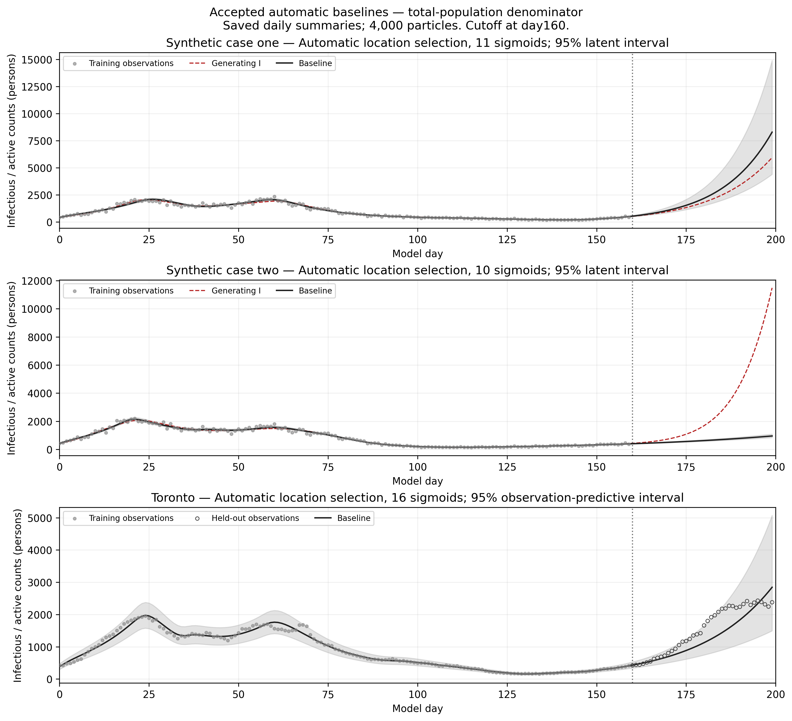

# Automatic location selection: accepted results

These saved results use the total-population denominator S+E+I+R+D, original
worker initialization, free beta0/amplitudes/E0/I0, 4,000 particles, seed 106 and
eight workers. Case one and Toronto use original adaptive 5–10 controls. Case
two uses fixed 50 attempted moves per chain at every stage, with adaptation off.
The original sampler files are unchanged; its isolated case-two control copy
changes only the existing adaptation flag and receives both move caps as 50.

The timing study contains 24 fresh runs and three verified accepted automatic
baselines reused. All 27 passed their training-region, direct-likelihood and
physical-forecast checks. This does not establish posterior convergence.

## Accepted automatic baselines

| Dataset | Sigmoids / parameters | Training RMSE (observed 0–159) | Forecast WIS11 | Forecast RMSE | 95% coverage | Mean 95% width |
|---|---:|---:|---:|---:|---:|---:|
| Synthetic case one | 11 / 14 | 107.26 | 281.14 | 894.06 | 100.0% | 2779.93 |
| Synthetic case two | 10 / 13 | 84.18 | 2329.88 | 3718.82 | 0.0% | 129.23 |
| Toronto | 16 / 19 | 73.59 | 202.58 | 387.07 | 90.0% | 1215.79 |

Synthetic targets are **generating latent infectious counts**; Toronto targets
are **reported active counts with observation noise included**. Scores average
exactly 40 daily times, days 160–199. Fit scores use days 1–159; inference uses
observations 0–159. Beta intervals are always latent. Means and equal-tail
pointwise intervals retain all 4,000 particles, including duplicates.



## Timing sensitivity

All locations move together by the stated shift. Each procedure retains its
baseline signs and prior bounds by sigmoid identity. No detection, pruning,
refinement, sign reselection or retry follows a shift. “Additional consolidation”
is the separate turn-associated procedure, not a BIC-selected/refined model.
Manual configurations are newly matched inference at saved manual dates, not
unchanged historical paper posteriors. Counts and dates differ between
procedures; this does not isolate a causal effect of sigmoid count.

| Dataset | Procedure | Sigmoids | WIS baseline | WIS −5 days | WIS +5 days |
|---|---|---:|---:|---:|---:|
| Synthetic case one | Manual locations | 5 | 65.26 | 1012.36 | 4929.96 |
| Synthetic case one | Automatic location selection | 11 | 281.14 | 492.16 | 812.16 |
| Synthetic case one | Additional consolidation | 10 | 502.20 | 384.10 | 459.72 |
| Synthetic case two | Manual locations | 5 | 2141.92 | 2150.48 | 2181.20 |
| Synthetic case two | Automatic location selection | 10 | 2329.88 | 2355.44 | 2298.71 |
| Synthetic case two | Additional consolidation | 9 | 2329.00 | 2355.44 | 2299.44 |
| Toronto | Manual locations | 5 | 732.74 | 174.69 | 4764.28 |
| Toronto | Automatic location selection | 16 | 202.58 | 329.17 | 256.08 |
| Toronto | Additional consolidation | 11 | 504.41 | 660.10 | 607.91 |

- Case one and Toronto retain material placement sensitivity. Automatic procedures
  avoid some extreme manual-shift forecasts in this test, but neither automatic
  procedure is uniformly best. One run per configuration mixes timing effects
  with Monte Carlo variation.
- Case two changes relatively little under these shifts, but all procedures miss
  the held-out rise. Low sensitivity is not reliable prediction. Provisional
  day 156 is absent from the accepted automatic list.
- Toronto automatic +5 days has higher coverage but wider intervals and worse
  RMSE/WIS than its baseline. Coverage alone is not forecast quality.
- Dates and signs were selected from data. Their uncertainty is excluded. The
  held-out curves were inspected in earlier development, so this is exploratory
  comparison, not untouched prospective validation. Original worker RNG states
  can duplicate, and tempering completion does not prove adequate exploration.

## Figures, tables and reproduction

- [Baseline PDF](../results/figures/accepted_baselines.pdf)
- [Timing sensitivity PDF](../results/figures/timing_sensitivity.pdf) / [PNG](../results/figures/timing_sensitivity.png)
- [Training detail PDF](../results/figures/training_detail.pdf)
- [Beta sensitivity PDF](../results/figures/beta_sensitivity.pdf) / [PNG](../results/figures/beta_sensitivity.png)
- [WIS table PDF](../results/figures/WIS11.pdf)
- [All 27 metrics](../results/timing_metrics.csv)
- [Accepted ML estimates, ML bounds and separate TMCMC supports](../results/accepted_ML_parameters.csv)
- [Exact configurations and signed priors](../results/timing_configurations.json)
- [Daily summaries](../results/daily_summaries.csv) and [schema/provenance](../results/summary_schema.json)

From `automatic_tuning/`:

```bash
python -B results/reproduce.py --check-only
python -B results/reproduce.py --output outputs/summary_figures
```

The script reads only bundled CSV/JSON files and performs no integration,
fitting or sampling. Published figures render the saved **daily** summaries;
original full-resolution archive figures are preserved separately. A different
Monte Carlo run need not reproduce these numerical values exactly.

WIS uses central coverages 10,20,…90,95,98% and the median, interval weights
alpha/2, median weight 0.5, normalization 11.5, then the arithmetic mean over
days. It follows [Bracher et al.](https://doi.org/10.1371/journal.pcbi.1008618),
with an independent exact-rational numerical check and quantile-loss check in
[wis11.py](../results/wis11.py). This is our implementation; equivalence to
Brandon’s code is unverified. Historical three-interval WIS is not mixed in.
Gaussian observation-predictive quantiles were obtained from the all-particle
mixture; synthetic quantiles are empirical, using linear interpolation.

No posterior arrays, trajectory ensembles, collaborator ZIPs, email, manuscript
or experimental archives are included here. Data source and license information
are in [DATA_LICENSES.txt](../handoff/DATA_LICENSES.txt).
